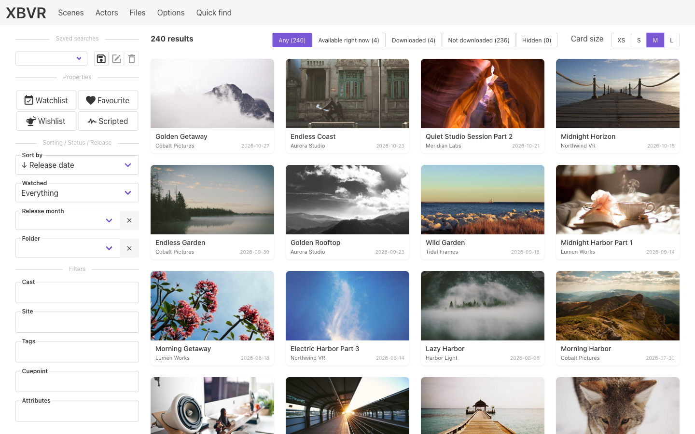
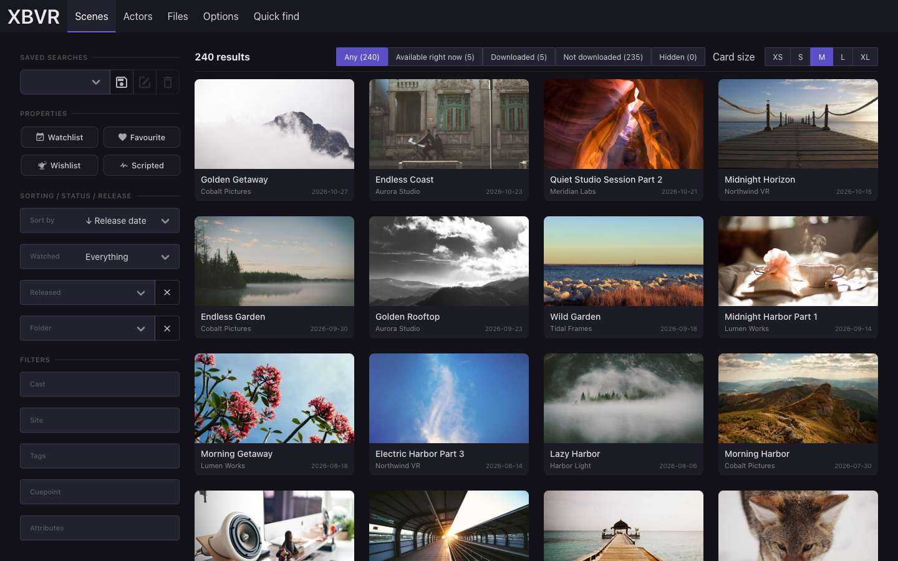

[](https://github.com/f0r3s1/xbvr/actions/workflows/lint.yml) [](https://github.com/f0r3s1/xbvr/releases)
<br>
<sup><sub><em>Docker • amd64 • arm64 • Raspberry Pi</em></sub></sup>

<h1 align="center">
    
</h1>

<h3 align="center">
    The ultimate tool for managing your VR video library.
</h3>

<p align="center">
    <strong>
        <a href="https://github.com/f0r3s1/xbvr/issues">Suggestions &amp; issues</a>
    </strong>
</p>

<p align="center">
    
    
    <br>
</p>


## Features

- Automatically match title, tags, cast, cover image, and more to your videos
- Support for all the most popular VR sites: BadoinkVR, CzechVR Network, DDFNetworkVR, MilfVR, NaughtyAmericaVR, SexBabesVR, StasyQVR, TmwVRnet, VirtualRealPorn, VirtualTaboo, VRBangers, VRHush, VRLatina, WankzVR and many studios on SexLikeReal
- Directly supports DeoVR and HereSphere VR players via API
- Built-in DLNA streaming server compatible with popular VR players (Pigasus, Skybox, Mobile Station VR)
- Sleek and simple web UI
- Browse your content by cast, site, tags, and release date
- Runs anywhere Docker does: amd64 and arm64 (including Raspberry Pi)

## Download

The latest version is always available on the [releases page](https://github.com/f0r3s1/xbvr/releases). Versions follow upstream XBVR plus a fork build number: `<upstream version>.<build>`.

XBVR ships as a Docker image, so it also runs on more specialized environments such as a QNAP NAS. Images are published to the [GitHub Container Registry](https://github.com/f0r3s1/xbvr/pkgs/container/xbvr).

To run the container:

```
docker run -t --name=xbvr --net=host --restart=always \
   --mount type=bind,source=/path/to/your/videos,target=/videos \
   --mount source=xbvr-config,target=/root/.config/ \
   ghcr.io/f0r3s1/xbvr:latest
```

Add `-d` to run the container in the background.

Your videos are mounted at `/videos`; add this path in Options -> Storage.

On first run, XBVR automatically downloads `ffprobe` and `ffmpeg` from [ffbinaries](https://ffbinaries.com/downloads).

## Quick Start

Once launched, the web UI is available at `http://127.0.0.1:9999`.

Before anything else, you must allow the app to scan sites and populate its scene metadata library. Click through to Options -> Scrapers and run the scrapers for the sites you use. This can take several minutes to complete. Wait for it to finish, and then go to Options -> Storage and add the folders where your video files are stored.

When that is done, your library is available in the web UI and in DeoVR or HereSphere (point the player at `http://<server-ip>:9999`). The DLNA server is off by default; turn it on in Options -> DLNA if your player needs it.

## Login and API access

Set `UI_USERNAME` and `UI_PASSWORD`, or turn on the player login in Options -> Players. Either login then protects the whole app: the web UI shows a sign-in page, DeoVR and HereSphere ask for the same credentials, and every video link handed to a player carries its own token. Scripts can use an API key from Options -> Advanced -> API key, sent as the `X-API-Key` header. Docker health checks use `/healthz`, which never needs a login.

Enjoy!

## Tech stack

This fork keeps its dependencies on current major versions, with lint and security checks on every push.

| Part | What it runs on |
| --- | --- |
| Backend | Go 1.26+ (built with Go 1.27), go-restful v3, Bleve v2 search, SQLite or MariaDB/MySQL |
| Web UI | Vue 3.5, Vite 8, Vue Router 5, Vuex 4, vue-i18n 11, Buefy for Vue 3 |
| Player | Video.js 10 with its own three.js VR view (180°, 360° and fisheye) |
| Tooling | Bun for the UI, golangci-lint and ESLint 10 in CI, Docker for every build and test |
| Releases | Multi-arch Docker images (amd64, arm64) and binaries for Windows, macOS (Apple silicon and Intel) and Linux (x86_64, arm64, Raspberry Pi armv7) |

## Questions & Suggestions

Ask your questions, report bugs and suggest features in the [issues](https://github.com/f0r3s1/xbvr/issues).

## Development

Everything runs in Docker. Only Docker and `make` are needed on the host; run `make help` to see every target.

| Command | What it does |
|---|---|
| `make dev` | Hot-reload dev environment (air + Vite HMR) on http://localhost:9999 |
| `make local` | Build the production image, run it on http://localhost:9999 and seed it with safe-for-work dummy data |
| `make local-seed` / `make local-reset` | Re-seed the local instance / wipe its data and media volumes |
| `make test` | Build and run the Go tests |
| `make lint` | gofmt, go vet, golangci-lint and eslint |
| `make ui-build` | Build the Vue/Vite UI bundle |
| `make vuln` | govulncheck + bun audit |
| `make deps-update` | Upgrade all Go modules and JS packages to latest |

The seeded instance (`scripts/seed-dev-data.mjs`) contains 240 fictional scenes with stock landscape photos, a few linked sample videos with funscripts, plus an unmatched video, a near-miss file name and an orphan funscript, so every file-matching state is visible in the UI.

## Tests

`make test` runs the suite (`-tags=json1` is required by the SQLite driver).

Scraper tests live in `pkg/scrape`:

- `registry_test.go` runs by default and needs no network. It checks that scraper registration is intact — unique IDs, populated fields, and that every site listed in the bundled `scrapers.json` actually registers a scraper. This catches a site silently disappearing from the UI.
- `live_test.go` makes real requests to the sites, so it is excluded unless you build with `-tags=scrapelive`. It catches what a site redesign does: selectors stop matching, the scraper emits nothing, and no error is raised anywhere.

Run them with `make test-live XBVR_SCRAPE_TARGETS=~/xbvr-scrape-targets.json`. `XBVR_SCRAPE_TARGETS` points at a JSON file kept outside the repository, listing one `{"scraper": "<id>", "url": "<scene url>"}` object per scraper you want covered. It is deliberately not checked in — the URLs are user-specific, and saved page fixtures would carry scene and performer names into the repo.

If you fix a scraper after a site change, adding a target entry for it is the cheapest way to find out when that site changes again.

### How To

#### Add specific filter to DeoVR
* On the XBVR scenes page, create a filter (cast, site, tags, etc.) and sort order, then create a "saved search" (see top left) and check "use as DeoVR list". 
* Inside DeoVR you will now see your saved search listed
#### Keyboard Shortcuts
* Global
? - Quick Find  
* Details Pane  
o - previous scene  
p - next scene  
e - edit scene  
w - toggle watchlist  
f - toggle favourite  
W - toggle Watched status (Capital W)  
g - toggles gallery / video window  
esc - closes details pane  
left arrow - cycles backwards in gallery / skips backwards in video  
right arrow - cycles forward in gallery / skips forward in video
* File Match Pane  
o - previous file  
p - next file  
left arrow - next page of search results  
right arrow - previous  page of search results  
esc - closes matching pane  
* Actor List  
o or left arrow - previous page of actors  
p or right arrow - next page of actors  
* Actor Details  
o - previous actor  
p - next actor  
left arrow - cycles backwards in gallery  
right arrow - cycles forward in gallery  
esc - closes details pane

#### using Command Line Arguments/Environment Variables
| Command line parameter | Environment Variable | Type | Description |
|------------------------|--------------|------|-------------|
| `--localstorage` | | boolean | Use local folder to store application data|
|	`--app_dir` | XBVR_APPDIR | String | path to the application directory|
|	`--cache_dir` | XBVR_CACHEDIR | String | path to the temporary scraper cache directory|
|	`--imgproxy_dir` | XBVR_IMAGEPROXYDIR | String | path to the imageproxy directory|
|	`--search_dir` | XBVR_SEARCHDIR | String | path to the Search Index directory|
|	`--preview_dir` | XBVR_VIDEOPREVIEWDIR | String | path to the Scraper Cache directory|
|	`--scripts_heatmap_dir` | XBVR_SCRIPTHEATMAPDIR | String| path to the scripts_heatmap directory|
|	`--myfiles_dir` | XBVR_MYFILESDIR | String | path to the myfiles directory for serving users own content (eg images|
|	`--database_url` | DATABASE_URL | String | override default database path|
|	`--web_port` | XBVR_WEB_PORT | Int | override default Web Page port 9999|
|	`--ws_addr` | XBVR_WS_ADDR | String | override default Websocket address from the default 0.0.0.0:9998 (127.0.0.1:9998 when a login is set)|
|	`--db_connection_pool_size` | DB_CONNECTION_POOL_SIZE | Int | sets the connection pool size for mariadb databases|
|	`--concurrent_scrapers` | CONCURRENT_SCRAPERS | Int | set the number of scrapers that run concurrently default 9999|
| | UI_USERNAME | String | username of the login that protects the web UI, API and players
| | UI_PASSWORD | String | password of that login
